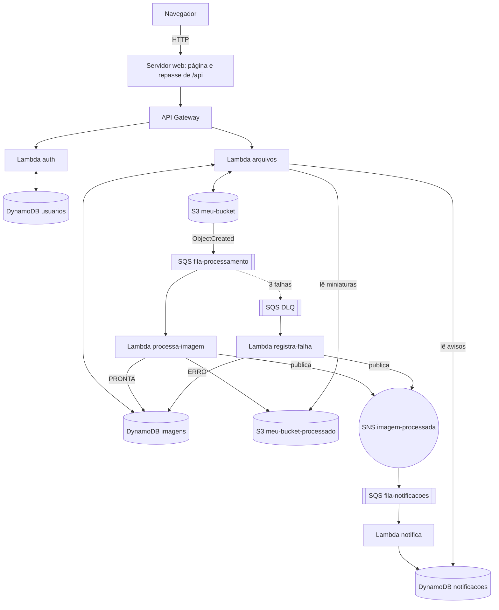

# CloudLens: definição e arquitetura

**Computação em Nuvem, 2026/2 · Atividade #1 G2**

**Equipe:** Geisbelly Victoria, Rafael Nunes e João Pedro

## 1. Definição

O CloudLens é uma galeria de imagens serverless. O usuário cria uma conta, envia imagens e recebe, para cada uma, uma miniatura em escala de cinza gerada em segundo plano. Quando o processamento termina (ou falha), o app mostra um aviso. Cada usuário só acessa os próprios arquivos.

O sistema roda inteiro na máquina, com Docker e LocalStack 3.8, sem conta AWS. Como a aula apresentou, o LocalStack simula os serviços da AWS localmente, com um endpoint unificado na porta 4566 e compatível com o SDK e a CLI oficiais, bastando trocar a endpoint URL [2][8].

## 2. Serviços exigidos pela atividade

A atividade pede no mínimo S3, Lambda, DynamoDB, SQS/SNS e API Gateway [2]. As definições abaixo seguem a aula de LocalStack [2]; a do SNS, que a aula cita junto com a SQS como mensageria, vem da documentação da AWS [7].

| Serviço | O que é | Papel no CloudLens |
|---|---|---|
| **API Gateway** | Cria, publica e gerencia APIs REST, HTTP ou WebSocket; é a porta de entrada do backend e integra com Lambda | Porta de entrada HTTP da lógica do sistema (REST, integração proxy com Lambda) |
| **Lambda** | Executa funções em resposta a eventos, sem gerenciar servidores; escala sozinha | Toda a lógica: 5 funções |
| **DynamoDB** | Banco NoSQL serverless, sem esquema fixo, com baixa latência e escala automática | Tabelas `usuarios`, `imagens` e `notificacoes` |
| **S3** | Armazenamento de objetos em buckets, com 11 noves de durabilidade e controle de acesso | `meu-bucket` (originais) e `meu-bucket-processado` (miniaturas) |
| **SQS** | Fila gerenciada para comunicação assíncrona e desacoplada; Standard (pode duplicar) ou FIFO | `fila-processamento`, `fila-processamento-dlq` e `fila-notificacoes`, todas Standard |
| **SNS** | Tópico que entrega cada mensagem publicada a todos os assinantes | Tópico `imagem-processada` |

## 3. Arquitetura

A Lambda `processa-imagem` também lê o original em `meu-bucket`.

## 4. Como as partes se comunicam

Há três formas de comunicação.

| Forma | Onde | Característica |
|---|---|---|
| Síncrona (requisição e resposta) | Navegador → servidor web → API Gateway → Lambda | O usuário espera a resposta |
| Evento por fila | S3 → SQS → Lambda | Desacopla o upload do processamento, com repetição e DLQ |
| Publicação e assinatura | Lambda → SNS → SQS → Lambda | Quem publica não conhece quem consome |

### 4.1 Cadastro e login
1. O navegador chama `POST /api/register` ou `POST /api/login`.
2. O servidor web repassa ao API Gateway, que invoca a Lambda `auth`.
3. No cadastro, a Lambda grava o usuário com escrita condicional (email repetido: 409). A senha é guardada só como hash bcrypt.
4. No login, ela confere o hash e devolve um JWT (HS256, 1 hora) em um cookie `HttpOnly`.

### 4.2 Upload e processamento
1. `POST /api/files` leva a imagem em base64. A Lambda `arquivos` valida o JWT, o tipo declarado e o tamanho (3 MB).
2. Ela registra a imagem como `PROCESSANDO`, grava o original no S3 e responde, sem esperar o processamento.
3. O S3 envia o evento `ObjectCreated` para a `fila-processamento`.
4. A Lambda `processa-imagem` consome a fila, gera a miniatura, grava no bucket de saída, marca `PRONTA` e publica no SNS.

### 4.3 Falhas
Se o processamento lança erro, a mensagem volta para a fila. Depois de 3 tentativas, vai para a DLQ [5]. A Lambda `registra-falha` marca a imagem como `ERRO` e publica o evento no mesmo tópico.

### 4.4 Notificação
O SNS entrega o evento à `fila-notificacoes`. A Lambda `notifica` grava o aviso no DynamoDB. O app consulta `GET /api/notifications` enquanto há algo em andamento e mostra o aviso na tela. O identificador do aviso é determinístico, então uma mensagem entregue duas vezes (o que a fila Standard permite [2]) não gera aviso duplicado.

### 4.5 Listagem e download
`GET /api/files` consulta a tabela `imagens`. `GET /api/files/{nome}` e `GET /api/processed/{nome}` leem o S3 por meio da Lambda. O navegador nunca acessa o S3 diretamente.

## 5. API

| Método e rota | Lambda | Exige login |
|---|---|---|
| POST /register | auth | não |
| POST /login | auth | não |
| POST /logout | auth | não |
| GET /me | auth | não (devolve vazio sem token) |
| POST /files | arquivos | sim |
| GET /files | arquivos | sim |
| GET /files/{key} | arquivos | sim |
| GET /processed/{key} | arquivos | sim |
| GET /notifications | arquivos | sim |

No navegador, as rotas têm o prefixo `/api`.

## 6. Dados

| Tabela | Chave de partição | Chave de ordenação | Atributos |
|---|---|---|---|
| `usuarios` | email | | name, passwordHash, createdAt |
| `imagens` | userId | imageKey | size, status, thumbKey, createdAt, updatedAt |
| `notificacoes` | userId | notificationId | imageKey, status, occurredAt |

`userId` são os 16 primeiros caracteres do SHA-256 do email. No S3, os objetos ficam em `{userId}/{timestamp}-{nome}`.

## 7. Decisões e limitações

- **JWT validado nas Lambdas.** Testamos um Lambda Authorizer em API REST no LocalStack 3.8 gratuito: ele não foi aplicado, e um token inválido recebeu HTTP 200. Por isso cada rota protegida valida o token. Na AWS real, essa validação iria para um Authorizer. É o limite que a aula aponta no LocalStack: nem todos os serviços têm paridade total com a AWS real [2].
- **Upload pela API.** O app não acessa o S3 diretamente. O limite de 3 MB mantém a requisição dentro do payload da Lambda.
- **Formatos.** PNG, JPEG, GIF e BMP, que a biblioteca de imagem processa. WebP é recusado. O conteúdo só é conferido no processamento; um arquivo corrompido segue o caminho da DLQ.
- **Visibility timeout de 30 s** (funções com timeout de 20 s), para a DLQ aparecer durante a demonstração. Em produção, a recomendação da AWS é cerca de 6 vezes o timeout da função [6].
- **Logout** apaga o cookie. O token não é revogado no servidor e vale até expirar.
- **Segurança de produção** fora do escopo: HTTPS, política de senha mais forte, limite de tentativas, papéis IAM mínimos (o LocalStack não os exige) e segredo no Secrets Manager. O segredo do JWT é gerado a cada deploy e não vai para o Git.
- **Persistência.** Os dados somem quando o contêiner do LocalStack é recriado.

## 8. Conceitos da disciplina aplicados ao CloudLens

Os conceitos desta seção vêm do Encontro 1 da disciplina [1], que define nuvem pelas cinco características do NIST [3]. O LocalStack simula as APIs da AWS, não o modelo operacional: não há cobrança, data center nem SLA. Esta seção descreve o sistema como ele seria implantado na AWS real.

### 8.1 Modelo de serviço
O critério da aula é saber quem aplica o patch de segurança [1].

| Parte | Modelo | O provedor cuida de | Nós cuidamos de |
|---|---|---|---|
| As 5 Lambdas | FaaS | Servidor, SO e runtime `nodejs20.x` | O código e as dependências (`bcryptjs`, `jimp`) |
| DynamoDB, SQS, SNS, API Gateway | PaaS (serviço gerenciado) | Tudo, inclusive capacidade e réplicas | Tabelas, filas, rotas e quem pode usá-las |
| S3 | Armazenamento gerenciado (fronteira IaaS/SaaS, como o Cloud Storage do exercício da aula) | Durabilidade e disponibilidade | O que é guardado e quem acessa |
| Servidor web | Contêiner no Swarm, que nós operamos | Nada | A imagem `node:20-alpine`, as dependências e as réplicas |

A lógica do sistema está toda em FaaS. Só o servidor web, que entrega a página e repassa `/api`, continua sendo um processo que alguém precisa manter no ar.

### 8.2 As cinco características do NIST

| Característica | Como aparece no CloudLens |
|---|---|
| Autoatendimento sob demanda | `deploy.js` cria buckets, tabelas, filas, tópico, funções e rotas pela API, sem abrir chamado |
| Amplo acesso via rede | O usuário usa HTTP pelo API Gateway; o deploy usa o SDK apontando para um endpoint |
| Agrupamento de recursos | Não escolhemos máquina: a Lambda roda onde o provedor decidir (no LocalStack, um contêiner por função) |
| Elasticidade rápida | A Lambda cria cópias conforme chegam requisições e mensagens; sem uso, não há nenhuma rodando |
| Serviço medido | Tabelas em `PAY_PER_REQUEST`; Lambda cobrada por invocação e milissegundo; SQS e SNS por requisição |

### 8.3 Elasticidade e escalabilidade
- **Escalável por arquitetura.** O servidor web não guarda estado (a sessão está no JWT) e a fila absorve picos de upload. Por isso dá para aumentar a capacidade sem mudar o código.
- **Elástico.** Lambda e DynamoDB sob demanda crescem e encolhem sozinhos. Com `BatchSize: 1`, cada imagem na fila vira uma invocação, e um pico de uploads vira mais invocações em paralelo, até o limite de concorrência da conta.
- **O Swarm é escalável, mas não elástico.** `docker service scale cloudlens_web=5` aumenta as réplicas, mas alguém precisa rodar o comando. Para ser elástico, precisaria de escala automática por métrica, como o ECS com Auto Scaling na AWS.

### 8.4 CapEx e OpEx
Não há servidor comprado nem dimensionado para o pico. Uma galeria usada por uma turma na semana de entrega paga só as invocações, requisições e o armazenamento daquela semana. Nas outras semanas, as Lambdas custam zero. O único item sempre ligado é o servidor web, e ele poderia ser trocado por hospedagem estática no S3 com o navegador chamando o API Gateway direto.

### 8.5 SLA composto
Valores mensais publicados pela AWS [4]: API Gateway 99,95%, Lambda 99,95%, DynamoDB 99,99% (tabela padrão) e S3 Standard 99,9% (limite abaixo do qual a AWS dá crédito).

| Caminho síncrono | Serviços em série | Disponibilidade | Queda tolerada |
|---|---|---|---|
| Login | API Gateway × Lambda × DynamoDB = 0,9995 × 0,9995 × 0,9999 | 99,89% | cerca de 47 min/mês |
| Upload | Login × S3 = 0,9989 × 0,999 | 99,79% | cerca de 1 h 31 min/mês (18 h/ano) |

O cálculo mostra a regra da aula: cada serviço em série puxa a disponibilidade para baixo, e nenhum caminho chega a 99,9%, embora quase todos os serviços tenham SLA maior que isso.

Duas decisões do CloudLens trabalham a favor:
- **A fila tira o processamento da série.** O upload responde assim que o original está no S3. Se a Lambda `processa-imagem` estiver fora, a mensagem espera na `fila-processamento` (4 dias por padrão, até 14) e é processada quando ela voltar. A indisponibilidade do processamento atrasa a miniatura, mas não derruba o upload.
- **As réplicas do servidor web ficam em paralelo.** Três réplicas independentes de 99% cada entregam 1 − 0,01³ = 99,9999%. A ressalva é que, no Swarm local, as três rodam na mesma máquina e não são independentes: se a máquina cai, todas caem. A redundância real exige réplicas em hosts ou zonas diferentes.

Pela leitura das cinco perguntas da aula, o SLA da AWS devolve crédito de serviço, não o prejuízo, e o crédito precisa ser pedido.

### 8.6 Responsabilidade compartilhada
O provedor responde pela segurança **da** nuvem: data center, hardware, rede física, hipervisor e o runtime das Lambdas. Nós respondemos pela segurança **na** nuvem, e em qualquer modelo os dados e o controle de acesso são nossos. No CloudLens:

- **Buckets privados.** O navegador nunca acessa o S3. Todo download passa pela Lambda `arquivos`, que monta a chave com o `userId` do token (`{userId}/{nome}`), então um usuário não consegue pedir o arquivo de outro.
- **Senhas e sessão.** A senha fica só como hash bcrypt. O JWT vai em cookie `HttpOnly`, e o segredo é gerado no deploy e não vai para o Git.
- **O caso do bucket público.** Se alguém deixasse o `meu-bucket` público, as fotos de todos os usuários ficariam expostas. A infraestrutura teria funcionado como foi configurada, o SLA não cobriria nada e a responsabilidade seria de quem opera o sistema.
- **LGPD.** Nome, email e as imagens enviadas são dados pessoais. Quem opera o CloudLens é o controlador e responde perante o titular. O que ainda falta para produção está na seção 7.

## 9. Docker Swarm (extra)

O servidor web não guarda estado: a sessão está no JWT. Por isso ele roda no Swarm com 3 réplicas (`stack.yml`), e o Swarm distribui as requisições entre elas. O cabeçalho `X-Replica` mostra qual contêiner respondeu. O LocalStack continua fora do Swarm, no Docker Compose.

## 10. Atividades de aula cobertas

| Atividade | Onde está |
|---|---|
| #1: upload, listagem e download no S3 | Lambda `arquivos` |
| #2: contas e autenticação no DynamoDB | Lambda `auth` |
| #3: Lambda acionada por upload, com saída em outro bucket | `processa-imagem` (o evento do S3 passa pela SQS) |
| G2: cinco serviços, comunicação e documento | Este sistema e este documento |

## 11. Relação com o Meu Controle

O Meu Controle é a proposta de um sistema de finanças pessoais, maior que o CloudLens. O CloudLens **não implementa** o Meu Controle: não há OCR, contas, transações nem a revisão de documentos. Ele demonstra o mesmo padrão de comunicação (API síncrona, processamento por fila com DLQ e aviso por SNS) em um escopo pequeno.

## 12. Verificação

`npm test` executa o fluxo de ponta a ponta no LocalStack: cadastro, login, rejeição de token ausente ou adulterado, limites de upload, processamento, download, aviso, isolamento entre usuários, DLQ e logout.

## 13. Referências

1. ULBRA. *Computação em Nuvem 2026/2. Encontro 1: Fundamentos e Panorama.* Slides de aula, 2026.
2. ULBRA. *Computação em Nuvem 2026/2. Introdução ao LocalStack*, partes 1 e 2 (inclui o enunciado da Atividade #1 G2). Slides de aula, 2026.
3. MELL, P.; GRANCE, T. *The NIST Definition of Cloud Computing.* NIST Special Publication 800-145. Gaithersburg: NIST, 2011.
4. AMAZON WEB SERVICES. *AWS Service Level Agreements.* Disponível em: <https://aws.amazon.com/legal/service-level-agreements/>.
5. AMAZON WEB SERVICES. *Amazon SQS Developer Guide: Amazon SQS dead-letter queues.* Disponível em: <https://docs.aws.amazon.com/AWSSimpleQueueService/latest/SQSDeveloperGuide/sqs-dead-letter-queues.html>.
6. AMAZON WEB SERVICES. *AWS Lambda Developer Guide: Using Lambda with Amazon SQS.* Disponível em: <https://docs.aws.amazon.com/lambda/latest/dg/with-sqs.html>.
7. AMAZON WEB SERVICES. *Amazon SNS Developer Guide.* Disponível em: <https://docs.aws.amazon.com/sns/latest/dg/welcome.html>.
8. LOCALSTACK. *LocalStack Documentation.* Disponível em: <https://docs.localstack.cloud/>.
