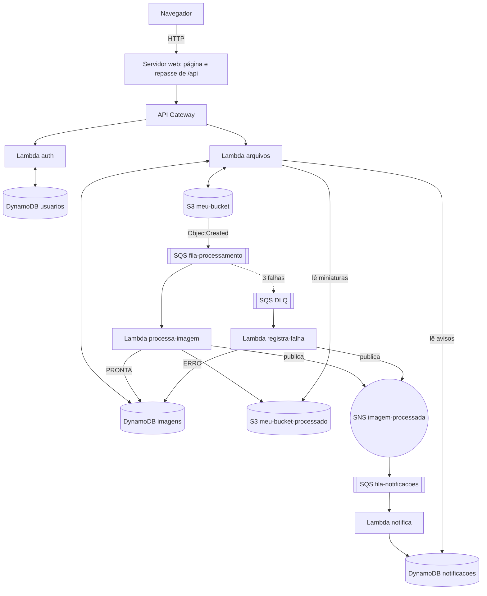

# CloudLens: definição e arquitetura

**Computação em Nuvem, 2026/2**
**Equipe:** Geisbelly Victoria, Rafael Nunes e João Pedro

## 1. Definição

O CloudLens é uma galeria de imagens serverless. O usuário cria uma conta, envia imagens e recebe, para cada uma, uma miniatura em escala de cinza gerada em segundo plano. Quando o processamento termina (ou falha), o app mostra um aviso. Cada usuário só acessa os próprios arquivos.

O sistema roda inteiro na máquina, com Docker e LocalStack 3.8, sem conta AWS.

## 2. Serviços exigidos pela atividade

| Serviço | Papel |
|---|---|
| **API Gateway** | Porta de entrada HTTP da lógica do sistema (REST, integração proxy com Lambda) |
| **Lambda** | Toda a lógica: 5 funções |
| **DynamoDB** | Tabelas `usuarios`, `imagens` e `notificacoes` |
| **S3** | `meu-bucket` (originais) e `meu-bucket-processado` (miniaturas) |
| **SQS** | `fila-processamento`, `fila-processamento-dlq` e `fila-notificacoes` |
| **SNS** | Tópico `imagem-processada` |

## 3. Arquitetura

A Lambda `processa-imagem` também lê o original em `meu-bucket`.

## 4. Como as partes se comunicam

Há três formas de comunicação.

| Forma | Onde | Característica |
|---|---|---|
| Síncrona (requisição e resposta) | Navegador → servidor web → API Gateway → Lambda | O usuário espera a resposta |
| Evento por fila | S3 → SQS → Lambda | Desacopla o upload do processamento, com repetição e DLQ |
| Publicação e assinatura | Lambda → SNS → SQS → Lambda | Quem publica não conhece quem consome |

### 4.1 Cadastro e login
1. O navegador chama `POST /api/register` ou `POST /api/login`.
2. O servidor web repassa ao API Gateway, que invoca a Lambda `auth`.
3. No cadastro, a Lambda grava o usuário com escrita condicional (email repetido: 409). A senha é guardada só como hash bcrypt.
4. No login, ela confere o hash e devolve um JWT (HS256, 1 hora) em um cookie `HttpOnly`.

### 4.2 Upload e processamento
1. `POST /api/files` leva a imagem em base64. A Lambda `arquivos` valida o JWT, o tipo declarado e o tamanho (3 MB).
2. Ela registra a imagem como `PROCESSANDO`, grava o original no S3 e responde, sem esperar o processamento.
3. O S3 envia o evento `ObjectCreated` para a `fila-processamento`.
4. A Lambda `processa-imagem` consome a fila, gera a miniatura, grava no bucket de saída, marca `PRONTA` e publica no SNS.

### 4.3 Falhas
Se o processamento lança erro, a mensagem volta para a fila. Depois de 3 tentativas, vai para a DLQ. A Lambda `registra-falha` marca a imagem como `ERRO` e publica o evento no mesmo tópico.

### 4.4 Notificação
O SNS entrega o evento à `fila-notificacoes`. A Lambda `notifica` grava o aviso no DynamoDB. O app consulta `GET /api/notifications` enquanto há algo em andamento e mostra o aviso na tela. O identificador do aviso é determinístico, então uma mensagem entregue duas vezes não gera aviso duplicado.

### 4.5 Listagem e download
`GET /api/files` consulta a tabela `imagens`. `GET /api/files/{nome}` e `GET /api/processed/{nome}` leem o S3 por meio da Lambda. O navegador nunca acessa o S3 diretamente.

## 5. API

| Método e rota | Lambda | Exige login |
|---|---|---|
| POST /register | auth | não |
| POST /login | auth | não |
| POST /logout | auth | não |
| GET /me | auth | não (devolve vazio sem token) |
| POST /files | arquivos | sim |
| GET /files | arquivos | sim |
| GET /files/{key} | arquivos | sim |
| GET /processed/{key} | arquivos | sim |
| GET /notifications | arquivos | sim |

No navegador, as rotas têm o prefixo `/api`.

## 6. Dados

| Tabela | Chave de partição | Chave de ordenação | Atributos |
|---|---|---|---|
| `usuarios` | email | | name, passwordHash, createdAt |
| `imagens` | userId | imageKey | size, status, thumbKey, createdAt, updatedAt |
| `notificacoes` | userId | notificationId | imageKey, status, occurredAt |

`userId` são os 16 primeiros caracteres do SHA-256 do email. No S3, os objetos ficam em `{userId}/{timestamp}-{nome}`.

## 7. Decisões e limitações

- **JWT validado nas Lambdas.** Testamos um Lambda Authorizer em API REST no LocalStack 3.8 gratuito: ele não foi aplicado, e um token inválido recebeu HTTP 200. Por isso cada rota protegida valida o token. Na AWS real, essa validação iria para um Authorizer.
- **Upload pela API.** O app não acessa o S3 diretamente. O limite de 3 MB mantém a requisição dentro do payload da Lambda.
- **Formatos.** PNG, JPEG, GIF e BMP, que a biblioteca de imagem processa. WebP é recusado. O conteúdo só é conferido no processamento; um arquivo corrompido segue o caminho da DLQ.
- **Visibility timeout de 30 s** (funções com timeout de 20 s), para a DLQ aparecer durante a demonstração. Em produção, a recomendação da AWS é cerca de 6 vezes o timeout da função.
- **Logout** apaga o cookie. O token não é revogado no servidor e vale até expirar.
- **Segurança de produção** fora do escopo: HTTPS, política de senha mais forte, limite de tentativas, papéis IAM mínimos (o LocalStack não os exige) e segredo no Secrets Manager. O segredo do JWT é gerado a cada deploy e não vai para o Git.
- **Persistência.** Os dados somem quando o contêiner do LocalStack é recriado.

## 8. Docker Swarm (extra)

O servidor web não guarda estado: a sessão está no JWT. Por isso ele roda no Swarm com 3 réplicas (`stack.yml`), e o Swarm distribui as requisições entre elas. O cabeçalho `X-Replica` mostra qual contêiner respondeu. O LocalStack continua fora do Swarm, no Docker Compose.

## 9. Atividades de aula cobertas

| Atividade | Onde está |
|---|---|
| #1: upload, listagem e download no S3 | Lambda `arquivos` |
| #2: contas e autenticação no DynamoDB | Lambda `auth` |
| #3: Lambda acionada por upload, com saída em outro bucket | `processa-imagem` (o evento do S3 passa pela SQS) |
| G2: cinco serviços, comunicação e documento | Este sistema e este documento |

## 10. Relação com o Meu Controle

O Meu Controle é a proposta de um sistema de finanças pessoais, maior que o CloudLens. O CloudLens **não implementa** o Meu Controle: não há OCR, contas, transações nem a revisão de documentos. Ele demonstra o mesmo padrão de comunicação (API síncrona, processamento por fila com DLQ e aviso por SNS) em um escopo pequeno.

## 11. Verificação

`npm test` executa o fluxo de ponta a ponta no LocalStack: cadastro, login, rejeição de token ausente ou adulterado, limites de upload, processamento, download, aviso, isolamento entre usuários, DLQ e logout.
